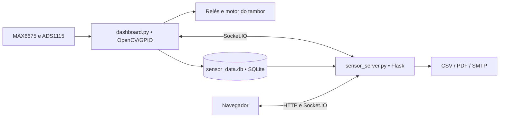

# TempPi — Monitoramento e controle no Raspberry Pi

Sistema de monitoramento de temperatura e pressão, histórico de sensores e controle de atuadores para um processo de destilação. Combina um painel local em OpenCV com uma interface web para operação, gráficos, calibração e relatórios.

O serviço web utiliza a porta **3333**. O coletor grava as leituras em SQLite no **horário do Brasil (UTC-3)**. Não é necessário um serviço de banco de dados separado.

## Sumário

- [Funcionalidades](#funcionalidades)
- [Arquitetura e tecnologias](#arquitetura-e-tecnologias)
- [Requisitos](#requisitos)
- [Instalação no Raspberry Pi](#instalação-no-raspberry-pi)
- [Como iniciar e parar](#como-iniciar-e-parar)
- [Demonstração web sem hardware](#demonstração-web-sem-hardware)
- [Como usar os painéis](#como-usar-os-painéis)
- [Data, hora e sincronização](#data-hora-e-sincronização)
- [Pinagem e argumentos](#pinagem-e-argumentos)
- [Dados, configurações e backup](#dados-configurações-e-backup)
- [Atalho e inicialização automática](#atalho-e-inicialização-automática)
- [API e comunicação em tempo real](#api-e-comunicação-em-tempo-real)
- [Testes e diagnóstico](#testes-e-diagnóstico)
- [Solução de problemas](#solução-de-problemas)
- [Estrutura do repositório](#estrutura-do-repositório)
- [Atualização do projeto](#atualização-do-projeto)

## Funcionalidades

| Área | Recursos disponíveis |
| --- | --- |
| Aquisição | Seis termopares MAX6675, pressão via ADS1115/I2C, validação dos sensores e modo de simulação. |
| Painel local | Valores sobrepostos à imagem da planta, relógio e escala da janela configurável. |
| Controle web | Modos automático/manual, aquecimento, ventilador, resistência, rosca de alimentação, ventilação do resfriador e tambor. |
| Tambor | Avanço/reverso contínuo, parada e ajuste da frequência de pulsos entre 100 e 2000 Hz pela interface. |
| Ajustes | Limites de temperatura do forno, parâmetros de pressão e tempos de acionamento/pausa, com persistência em arquivo. |
| Calibração | Ganho e offset da pressão, sugestão com leitura de referência, cálculo por dois pontos e pré-visualização. |
| Histórico | Leituras persistidas aproximadamente a cada 5 segundos, filtros por sensor/período, estatísticas e paginação. |
| Gráficos individuais | Temperatura, pressão e velocidade, valores atuais, mínimos, máximos, médias e dados recentes. |
| Todos os sensores | Gráfico consolidado, seleção das séries, períodos predefinidos/customizados, agrupamento, tabela paginada e pressão em PSI/bar. |
| Relatórios | CSV, PDF com gráfico e tabela, nome da operação, comentários e envio por e-mail. |
| Configuração | SMTP, teste de envio, informações de acesso pela rede e reset do histórico com confirmações na interface. |
| Operação | Logs locais, checagem de sincronização do relógio, atalhos de desktop e autostart na sessão gráfica. |

**Comportamentos atuais:** a variável de velocidade exibida é simulada, inclusive no modo Raspberry Pi; ela não é uma medição por encoder. Quando os sensores estão parcialmente disponíveis, também existe fallback simulado de pressão em `compute_values()`. Os parâmetros de pressão e o tempo de resistência podem ser configurados, mas a lógica automática atual usa principalmente os limites do forno e o ciclo da rosca; não representam controle fechado de pressão.

## Arquitetura e tecnologias



- **Coletor e controle:** Python, OpenCV, NumPy, RPi.GPIO, Adafruit Blinka/ADS1x15 e cliente python-socketio.
- **Servidor:** Flask e Flask-SocketIO; `sensor_server.py` escuta em `0.0.0.0:3333`.
- **Interface:** HTML/Jinja, JavaScript, Bootstrap, Chart.js e Socket.IO.
- **Persistência:** SQLite para leituras, calibração e SMTP; `settings.json` para ajustes de operação.
- **Relatórios:** Matplotlib, ReportLab, Pillow e SMTP.

O navegador envia comandos ao servidor, que os encaminha ao coletor. O coletor aplica os comandos e transmite seu estado de volta à interface. Os dois processos devem estar ativos para controlar o hardware; o servidor sozinho permite consultar um histórico já existente.

## Requisitos

### Para operação completa

- Raspberry Pi com Raspberry Pi OS e sessão gráfica para a janela OpenCV.
- Python 3.9 ou superior, `pip`, `venv` e as dependências de [requirements.txt](requirements.txt).
- I2C habilitado para o ADS1115 e permissões de acesso a GPIO/I2C.
- Imagem da planta em [assets/base.jpeg](assets/base.jpeg).
- Navegador e acesso à rede local para os painéis remotos.
- Internet durante a instalação das dependências e acesso ao servidor SMTP para enviar e-mails.

A interface carrega Bootstrap, Chart.js, Font Awesome e Socket.IO por CDN. O coletor e o banco são locais, mas a interface web ainda não oferece garantia de funcionamento integral sem internet/cache desses arquivos.

### Para desenvolvimento sem GPIO

O servidor web e os testes em `tests/` podem ser executados sem OpenCV ou hardware. Use a [demonstração web](#demonstração-web-sem-hardware) para esse cenário. Node.js 18+ é utilizado apenas nos testes JavaScript.

## Instalação no Raspberry Pi

Execute os comandos em um terminal do Raspberry Pi. O diretório abaixo também é o caminho padrão dos atalhos incluídos no projeto; ajuste-o se usar outro usuário ou pasta.

```bash
sudo apt update
sudo apt install -y git curl lsof sqlite3 python3-dev python3-pip python3-venv i2c-tools

mkdir -p ~/Documentos
cd ~/Documentos
git clone --branch main https://github.com/rogerin/tempPi.git
cd tempPi

bash install_rpi.sh
source .venv/bin/activate
python3 -m pip install -r requirements.txt
```

O instalador prepara as bibliotecas de hardware. A instalação de `requirements.txt` completa também as dependências de WebSocket e relatórios.

Habilite o I2C:

```bash
sudo raspi-config
# Interface Options → I2C → Enable
```

Reinicie se o sistema solicitar. Depois confira o barramento:

```bash
sudo i2cdetect -y 1
```

Com a configuração padrão, o ADS1115 utiliza o endereço `0x48`, canal A0, SDA no GPIO 2 e SCL no GPIO 3.

## Como iniciar e parar

### Inicialização integrada

Na raiz do projeto:

```bash
./setup_run.sh
```

O script verifica o relógio, cria/ativa `.venv`, verifica dependências, inicia o servidor e depois o coletor. Também tenta abrir o navegador no painel de controle e grava os logs em `logs/`.

**A inicialização padrão executa uma rotina de teste que aciona atuadores.** Para iniciar sem essa rotina, use os comandos manuais com `--skip-test`, mostrados abaixo. Essa opção não desativa o controle automático configurado nem a validação dos sensores.

Para forçar uma nova instalação das dependências:

```bash
./setup_run.sh --force-install
```

O script assume hardware Raspberry Pi quando `uname` retorna `Linux`. Em um computador Linux comum, use o servidor isolado ou a execução manual adequada ao ambiente. No macOS, o script reinstala NumPy/OpenCV a cada execução.

### Execução manual

Use dois terminais, ambos na raiz do projeto, e inicie o servidor primeiro.

**Terminal 1 — servidor web:**

```bash
source .venv/bin/activate
python3 sensor_server.py
```

**Terminal 2 — coletor e controle do Raspberry Pi:**

```bash
source .venv/bin/activate
python3 dashboard.py --img assets/base.jpeg --use-rpi --skip-test
```

Para executar também a rotina de teste dos atuadores, remova `--skip-test`.

O coletor cria as tabelas de leituras e status ao iniciar. Antes da primeira inicialização dele, algumas consultas do servidor podem não ter dados ou tabelas disponíveis.

### Endereços

| Página | Endereço local |
| --- | --- |
| Início e histórico | <http://localhost:3333/> |
| Controle de atuadores | <http://localhost:3333/control> |
| Todos os sensores | <http://localhost:3333/sensor/all> |
| Configuração SMTP e sistema | <http://localhost:3333/config> |
| Sensor individual | Menu **Sensores** → nome do sensor |

Para acessar de outro dispositivo na mesma rede, substitua `localhost` pelo IP do Raspberry Pi: `http://IP_DO_RASPBERRY:3333`. Consulte o endereço em **Configurações → Acesso Remoto** ou com `hostname -I` no Raspberry Pi.

A versão atual não possui autenticação nas rotas de controle/configuração e usa HTTP. O acesso deve ficar restrito à rede de operação; ela não está preparada para exposição direta à internet.

### Encerramento

- No painel OpenCV, pressione **Esc** para encerrar o coletor.
- Com `setup_run.sh`, use **Ctrl+C** no terminal para encerrar os processos.
- Na execução manual, encerre coletor e servidor em seus respectivos terminais.

Execute uma única instância por equipamento. A limpeza do `setup_run.sh` encerra processos com os nomes `dashboard.py`/`sensor_server.py` e processos na porta `3333`.

## Demonstração web sem hardware

Use um checkout separado do ambiente de operação, pois este procedimento grava dados simulados em `sensor_data.db`:

```bash
git clone --branch feature/temp-control https://github.com/rogerin/tempPi.git tempPi-demo
cd tempPi-demo
python3 -m venv .venv
source .venv/bin/activate
python3 -m pip install Flask Flask-SocketIO python-socketio eventlet matplotlib reportlab Pillow requests

# Inicializa somente a tabela; não executa o script de teste destrutivo.
python3 -c "from test_db import init_database; init_database()"
python3 generate_test_data.py
python3 sensor_server.py
```

Abra <http://localhost:3333/sensor/all>. O gerador adiciona 24 horas de dados simulados, com uma amostra a cada 5 minutos para cada sensor. Se já houver registros, ele não adiciona novas amostras sem uma opção explícita como `-y`.

Esse modo permite explorar histórico, filtros e relatórios, mas não mantém coleta em tempo real nem executa comandos de hardware.

O coletor também possui um modo de simulação:

```bash
python3 dashboard.py --img assets/base.jpeg --skip-test
```

Ele ainda exige sessão gráfica e importa `board`, `busio` e bibliotecas Adafruit no início do arquivo, mesmo sem `--use-rpi`. Por isso, sua execução em computadores sem suporte a essas bibliotecas não é garantida. Para visualizar o projeto sem hardware, prefira a demonstração web acima.

## Como usar os painéis

### Controle e modos de operação

Em `/control`, acompanhe a conexão, as leituras, o status dos sensores e dos atuadores.

- **Manual:** acione ventilador, resistência, rosca e ventilação do resfriador. Os comandos comuns de relés são aplicados pelo coletor no modo manual.
- **Tambor:** selecione avanço ou reverso; repetir o comando da direção ativa interrompe a rotação. A interface permite ajustar a frequência em Hz e mostra uma estimativa de RPM.
- **Automático:** habilite o aquecimento e ajuste os limites do forno e os tempos da rosca.

A lógica automática atual funciona assim:

| Condição | Comportamento implementado |
| --- | --- |
| Aquecimento desligado ou leitura do forno ausente | Desliga ventilador, resistência e rosca; interrompe o tambor. |
| Forno abaixo da temperatura mínima | Liga resistência e ventilador, alterna acionamento/pausa da rosca e inicia o tambor para frente. |
| Forno entre mínima e máxima | Desliga resistência, mantém ventilador, ciclo da rosca e tambor. |
| Forno acima da máxima | Desliga ventilador, resistência e rosca. Esse ramo não contém uma parada explícita do tambor. |

As mudanças de ajustes são persistidas em `settings.json`. A ventilação do resfriador possui acionamento manual; não há regra automática específica para ela nessa função de controle.

### Calibração da pressão

No painel de controle, abra **Calibrar pressão**:

1. Informe a leitura do sistema e uma leitura de referência.
2. Use **Sugerir** para estimar o ganho, ou preencha dois pares de medições para calcular ganho e offset.
3. Confira a pré-visualização e clique em **Salvar**.

A correção aplicada é `pressão corrigida = pressão calculada × ganho + offset`, com resultado limitado a zero como mínimo. Os parâmetros ficam na tabela `calibration`; os padrões são ganho `1` e offset `0`.

### Todos os sensores e período customizado

Em `/sensor/all`:

1. Selecione **1h**, **6h**, **24h**, **3 dias**, **1 semana** ou **Período customizado**.
2. No período customizado, preencha início e fim no **horário do Brasil, UTC-3**.
3. Escolha as séries, a unidade de pressão e o agrupamento.
4. Clique em **Atualizar**.

O minuto final é incluído por inteiro: `10:00` até `11:00` inclui leituras até `11:00:59`. Datas inválidas, incompletas ou invertidas geram uma mensagem. Uma consulta vazia mantém o gráfico disponível para a próxima busca.

Os agrupamentos disponíveis são **2, 4, 6, 10 e 30 segundos; 1, 5 e 15 minutos; 1 hora; 1 dia**, além de **sem agrupamento**. Os grupos calculam médias por sensor. A tabela mostra 50 linhas por página e o gráfico limita a renderização aos últimos 10.000 registros retornados; use agrupamento para períodos extensos.

Os cartões de valores atuais são atualizados a cada 5 segundos. O botão **Auto-refresh** habilita a atualização do gráfico a cada 30 segundos.

### Relatórios e exportação

- **CSV:** exporta as leituras do período. O botão de Excel/CSV gera `.csv`, não uma planilha `.xlsx`. Na tela consolidada, essa exportação usa o período e mantém as leituras brutas de todos os sensores, sem aplicar o agrupamento do gráfico.
- **PDF consolidado:** utiliza período, agrupamento, sensores selecionados e unidade de pressão; inclui gráfico, tabela, nome da operação e comentários opcionais.
- **E-mail:** permite enviar o PDF consolidado pelo modal de relatório. Há também envio de relatório nas páginas de sensor individual e controle.

A tela **Todos os sensores**, o CSV correspondente e o PDF consolidado usam a mesma normalização dos limites de data. Os fluxos de relatório das outras páginas possuem endpoints próprios.

Para configurar e-mail:

1. Acesse `/config` e informe servidor, porta, usuário, senha, remetente e nome do remetente.
2. Clique em **Salvar Configurações**.
3. Use **Testar Conexão**; essa ação envia um e-mail de teste ao remetente configurado.
4. Abra o relatório desejado e informe o destinatário.

Utilize os dados de SMTP fornecidos pelo serviço de e-mail. As configurações, incluindo a credencial SMTP, ficam no banco local; trate o arquivo e seus backups como dados privados.

### Administração

A página `/config` mostra informações de acesso remoto e oferece reset do histórico com duas confirmações. O reset apaga os registros de `sensor_readings`; não remove calibração, configuração SMTP ou `settings.json`.

## Data, hora e sincronização

`setup_run.sh`, `sensor_server.py` e `dashboard.py` executam uma checagem do relógio na inicialização. Ela mostra hora local/UTC e consulta o estado de sincronização do sistema, com timeout de 5 segundos.

```bash
python3 check_server_time.py
```

| Saída do comando | Significado |
| --- | --- |
| Código `0` | O sistema informou que o relógio está sincronizado. |
| Código `1` | Não está sincronizado ou não foi possível confirmar o estado. |

Nos aplicativos, o diagnóstico gera aviso e permite continuar. Ele não altera relógio, fuso ou registros. Para conferir e habilitar a sincronização no Raspberry Pi:

```bash
timedatectl status
sudo timedatectl set-ntp true
timedatectl show --property=NTPSynchronized --value
```

Aguarde a última consulta retornar `yes`. O diagnóstico consulta o estado do sistema; não mede diretamente a diferença em relação a um servidor externo.

O coletor desta versão grava timestamps como `AAAA-MM-DD HH:MM:SS` em UTC-3. Os filtros aceitam ISO 8601, convertem offsets explícitos para UTC-3 e interpretam datas sem offset como horário do Brasil. O agrupamento não aplica novamente o fuso do servidor. Registros antigos gravados com hora incorreta mantêm seus timestamps originais.

## Pinagem e argumentos

A numeração abaixo é **BCM/GPIO**, conforme os valores padrão de `dashboard.py`, e não a posição física do conector.

### Temperatura — MAX6675

| Sensor | SCK | CS | SO | Argumento |
| --- | --- | --- | --- | --- |
| Torre nível 1 | 25 | 24 | 18 | `--thermo-torre1` |
| Torre nível 2 | 7 | 8 | 23 | `--thermo-torre2` |
| Torre nível 3 | 21 | 20 | 16 | `--thermo-torre3` |
| Tanque | 4 | 15 | 0 | `--thermo-tanque` |
| Saída de gases | 22 | 27 | 17 | `--thermo-gases` |
| Forno | 11 | 9 | 10 | `--thermo-forno` |

O protocolo MAX6675 é implementado no projeto com RPi.GPIO, sem pacote MAX6675 externo.

### Pressão e atuadores

| Componente | GPIO/configuração | Argumento |
| --- | --- | --- |
| ADS1115 | SDA `2`, SCL `3`, endereço `0x48`, canal A0 | Configurado na classe `PressureSensorADS1115` |
| Ventilador | 14 | `--ventilador-pin` |
| Resistência | 26 | `--resistencia-pin` |
| Rosca de alimentação | 12 | `--motor-rosca-pin` |
| Ventilação do resfriador | 13 | `--ventilacao-resfriador-pin` |
| Tambor: direção | 6 | `--tambor-dir-pin` |
| Tambor: pulsos | 19 | `--tambor-pul-pin` |
| Tambor: habilitação | 5 | `--tambor-ena-pin` |

Os relés usam lógica invertida: `LOW` liga e `HIGH` desliga. O driver do tambor também usa ENA ativo em `LOW`. Os argumentos legados `--pressao1-pin` e `--pressao2-pin` existem, mas não substituem a configuração de endereço/canal do ADS1115.

O cálculo de pressão parte de um transdutor de 0–30 PSI com saída nominal de 0,5–4,5 V. A montagem e a calibração devem corresponder ao condicionamento elétrico utilizado. A referência adicional de conexões está em [pinagem-raspberry-pi.md](pinagem-raspberry-pi.md); alguns comentários históricos desse arquivo divergem dos padrões atuais, listados acima.

### Opções de execução

| Opção | Uso |
| --- | --- |
| `--img CAMINHO` | Imagem de fundo; obrigatório. |
| `--scale FATOR` | Escala da janela; padrão `1.0`. |
| `--use-rpi` | Habilita o caminho de leitura e controle de hardware. |
| `--skip-test` | Pula a rotina inicial dos atuadores; não pula a validação dos sensores. |
| `--thermo-* SCK CS SO` | Define os três GPIOs de um termopar. |
| Argumentos de atuadores | Definem individualmente os GPIOs da tabela. |

Exemplo:

```bash
python3 dashboard.py --img assets/base.jpeg --use-rpi --skip-test \
  --scale 0.8 --thermo-tanque 4 15 0 --tambor-dir-pin 6 --tambor-ena-pin 5
```

Com as dependências do coletor disponíveis, consulte `python3 dashboard.py --help` para todas as opções.

## Dados, configurações e backup

Execute os processos na raiz do projeto: os caminhos de banco e configurações são relativos ao diretório de execução.

| Arquivo | Conteúdo |
| --- | --- |
| `sensor_data.db` | Leituras, status de sensores, calibração e configurações SMTP. |
| `settings.json` | Modo, aquecimento, limites, temporizações e velocidade do tambor. |
| `logs/server.log` | Saída do servidor iniciado pelo script integrado. |
| `logs/dashboard.log` | Saída do coletor iniciado pelo script integrado. |

Esses arquivos de execução são ignorados pelo Git. Os logs são sobrescritos a cada início pelo script; copie-os antes de reiniciar se precisar preservar uma ocorrência.

Com os processos encerrados, faça uma cópia antes de atualizar ou limpar o histórico:

```bash
mkdir -p /caminho/do/backup/temppi
cp sensor_data.db /caminho/do/backup/temppi/
# Execute se settings.json já existir:
cp settings.json /caminho/do/backup/temppi/
```

Para restaurar, encerre os processos, recoloque os arquivos na raiz do projeto e inicie novamente. O backup do banco contém também a configuração SMTP.

## Atalho e inicialização automática

### Atalho na área de trabalho

Os arquivos `start_temppi.sh`, `TempPi.desktop` e `TempPi-raspberry.desktop` utilizam o caminho `/home/admin/Documentos/tempPi`. Ajuste esse caminho antes de instalar o atalho se seu checkout estiver em outra pasta.

```bash
chmod +x start_temppi.sh install_desktop.sh
./install_desktop.sh
```

O instalador copia o atalho para `~/Desktop/TempPi.desktop` e pode adicioná-lo ao menu de aplicativos. Ele pressupõe que `~/Desktop` existe. Veja [DESKTOP_README.md](DESKTOP_README.md) para detalhes.

### Iniciar ao entrar na sessão gráfica

Crie `~/.config/autostart/temppi.desktop` com o caminho real do projeto:

```ini
[Desktop Entry]
Type=Application
Name=TempPi Dashboard
Exec=/bin/bash -c "cd /home/admin/Documentos/tempPi && exec ./setup_run.sh"
Terminal=false
X-GNOME-Autostart-enabled=true
```

Esse mecanismo roda ao entrar na sessão gráfica; não é um serviço headless do systemd. Ele usa a mesma rotina padrão de inicialização dos atuadores. Instruções complementares: [AUTOSTART_INSTRUCTIONS.md](AUTOSTART_INSTRUCTIONS.md).

## API e comunicação em tempo real

As rotas são implementadas em [sensor_server.py](sensor_server.py).

| Método | Rota | Finalidade |
| --- | --- | --- |
| GET | `/api/sensors` | Lista os nomes dos sensores. |
| GET | `/api/readings` | Leituras paginadas; filtros `sensor`, `start`, `end`, `page`. |
| GET | `/api/readings/export` | CSV; filtros `sensor`, `start`, `end`. |
| GET | `/api/stats` | Estatísticas gerais. |
| GET | `/api/health/sensors` | Status dos sensores. |
| GET | `/api/sensor/<sensor_name>/data` | Histórico individual; parâmetro `hours`. |
| GET | `/api/all-sensors/data` | Histórico consolidado; `hours` ou `start_time`/`end_time`, mais `group_by`. |
| GET | `/api/all-sensors/latest` | Último conjunto de leituras. |
| GET | `/api/all-sensors/recent` | Conjuntos recentes; parâmetro `limit`. |
| GET/POST | `/api/config/smtp` | Consulta e salva SMTP. |
| POST | `/api/config/test-smtp` | Envia e-mail de teste. |
| GET/POST | `/api/config/pressure-calibration` | Consulta e salva ganho/offset. |
| POST | `/api/reports/generate-pdf` | Gera o PDF consolidado. |
| POST | `/api/reports/send-consolidated-email` | Envia o PDF consolidado por e-mail. |
| POST | `/api/reports/send-email` | Relatório do sensor individual. |
| POST | `/api/report/send` | Relatório solicitado pelo painel de controle. |
| POST | `/api/admin/reset-sensor-data` | Apaga todas as leituras. |
| GET | `/api/system/network-info` | IP, hostname, porta e URL de acesso. |

Exemplo de consulta sem alterar dados:

```bash
curl --get 'http://localhost:3333/api/all-sensors/data' \
  --data-urlencode 'start_time=2026-10-14T10:00' \
  --data-urlencode 'end_time=2026-10-14T11:00' \
  --data-urlencode 'group_by=1min'
```

Substitua as datas pelo período desejado. Erros de data na consulta consolidada retornam HTTP `400` com a chave `error`; uma consulta válida sem registros retorna `[]`.

Socket.IO utiliza os namespaces `/web` e `/dashboard`. O navegador envia `control_event`; o servidor encaminha `command_from_server` ao coletor. As atualizações `dashboard_update` retornam ao navegador como `update_from_dashboard`.

## Testes e diagnóstico

### Regressão sem hardware

Com o ambiente virtual ativo e as dependências web/relatórios instaladas:

```bash
python3 -m unittest discover -s tests -v
node --test tests/test_all_sensors.js
```

A suíte usa SQLite temporário, testa o período customizado, fusos, agrupamento, CSV, PDF, validação da interface e diagnóstico do relógio. Não aciona GPIO nem envia e-mails.

### Testes de hardware

Com a aplicação principal parada e o hardware preparado para acionamento:

```bash
# Diagnóstico do ADS1115
python3 test_ads1115.py

# Aciona fisicamente o motor se RPi.GPIO estiver disponível
python3 test_motor.py --steps 200 --direction forward --speed 500
python3 test_motor.py --interactive
```

O script do motor também oferece `--sequence` e direção `reverse`. Os GPIOs atuais do teste são DIR `6`, PUL `19` e ENA `5`.

### Scripts auxiliares existentes

| Script | Observação |
| --- | --- |
| `generate_test_data.py` | Adiciona dados simulados a uma tabela já criada; use em banco de demonstração. |
| `test_pdf_generation.py` | Requer servidor e dados; grava `test_report.pdf`. |
| `test_report_backend.py` | Insere dados no banco local e pode enviar e-mail real. |
| `test_db.py` / `test_system.py` | Quando executados como scripts, removem o banco existente; não use no banco de operação. |
| `run_demo.sh` | Fluxo antigo que inicia o coletor antes do servidor; prefira a demonstração web deste README. |
| `configure_smtp.py` | Utilitário auxiliar de SMTP; prefira configurar pela página `/config`. |

## Solução de problemas

| Sintoma | O que conferir |
| --- | --- |
| Não abre no navegador | Use porta `3333`, confira se o servidor iniciou e leia `logs/server.log`. Algumas mensagens de scripts antigos ainda citam `8080`. |
| Porta ocupada | Execute `lsof -i :3333` e identifique a instância que já está em execução. |
| Painel sem conexão | Inicie `sensor_server.py` antes de `dashboard.py`; o coletor conecta a `http://localhost:3333`. |
| `no such table: sensor_readings` | O coletor ainda não inicializou esse banco ou os processos foram abertos em diretórios diferentes. |
| Período sem registros | Confira UTC-3, início/fim, relógio do equipamento e existência de dados no período. Clique em **Atualizar**. |
| Gráfico incompleto em período longo | A renderização usa no máximo 10.000 registros; selecione um agrupamento maior. |
| Pressão indisponível | Confira I2C, endereço `0x48`, canal A0, ligação do transdutor e calibração; rode `test_ads1115.py`. |
| Falha de termopar | Confira SCK/CS/SO e os resultados de validação no log do coletor. |
| `ModuleNotFoundError` | Ative `.venv` e instale as dependências do ambiente correto. Os imports Adafruit do coletor também ocorrem em simulação. |
| Janela OpenCV não abre | O coletor precisa de sessão gráfica e uma imagem válida. Para histórico sem monitor, execute apenas o servidor. |
| Falha no e-mail | Confira configuração SMTP, conectividade e o retorno do teste em `/config`. |
| Interface sem estilos/gráficos | Confira acesso às CDNs utilizadas em `templates/base.html`. |
| Atalho não abre | Confira caminhos `/home/admin/Documentos/tempPi`, terminal instalado e permissões do script. |

Comandos úteis:

```bash
tail -n 100 logs/server.log
tail -n 100 logs/dashboard.log
curl -I http://localhost:3333/
curl http://localhost:3333/api/health/sensors
python3 check_server_time.py
```

Os gráficos de visão geral/média da página inicial ainda têm carregadores desabilitados em `static/js/dashboard.js`. Para gráficos funcionais, use **Todos os sensores** ou a página individual. O projeto também pode continuar em modo degradado quando sensores falham; a presença da página web não confirma que todas as leituras sejam reais.

## Estrutura do repositório

```text
tempPi/
├── dashboard.py                # Coletor, controle, GPIO e painel OpenCV
├── sensor_server.py            # HTTP, Socket.IO, consultas e relatórios
├── check_server_time.py        # Diagnóstico do relógio
├── requirements.txt            # Dependências Python
├── setup_run.sh                # Inicialização integrada
├── install_rpi.sh              # Preparação do Raspberry Pi
├── start_temppi.sh              # Inicialização pelo atalho
├── install_desktop.sh          # Instalação do atalho
├── templates/                  # Telas HTML/Jinja
├── static/                     # JavaScript, CSS e imagens
├── assets/base.jpeg            # Imagem do painel local
├── tests/                      # Regressões isoladas, sem hardware
├── test_ads1115.py              # Diagnóstico do ADC/pressão
├── test_motor.py                # Teste do motor do tambor
├── generate_test_data.py        # Histórico sintético
├── docs/                       # Documentação anterior em HTML/PDF
├── sensor_data.db              # Banco local gerado em execução
├── settings.json               # Ajustes locais gerados em execução
└── logs/                       # Logs gerados em execução
```

`dash-com-as-config.py` é uma variante mantida no repositório; o caminho de inicialização documentado usa `dashboard.py`. Os materiais de `docs/` descrevem versões anteriores e podem divergir da implementação atual.

## Atualização do projeto

O desenvolvimento é feito em `feature/temp-control`; as atualizações liberadas são integradas à `main`. Para atualizar um equipamento que utiliza `main`, encerre os processos, faça backup dos dados e execute na raiz:

```bash
git status --short
git switch main
git pull --ff-only origin main
source .venv/bin/activate
python3 -m pip install -r requirements.txt
./setup_run.sh
```

Se houver mudanças locais ou o Git não puder avançar por fast-forward, resolva a divergência antes de continuar. Bancos, configurações locais e logs não fazem parte do conteúdo versionado.
